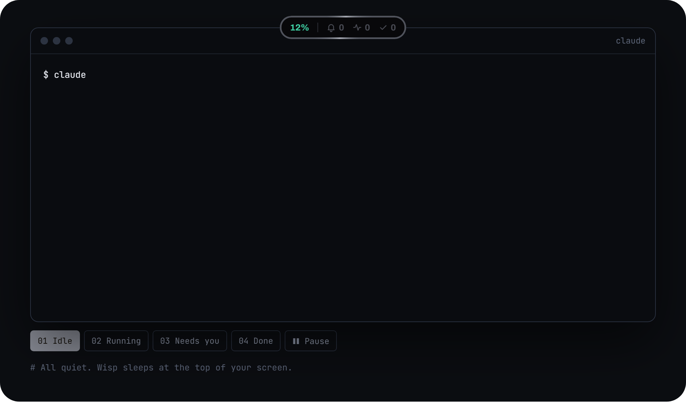
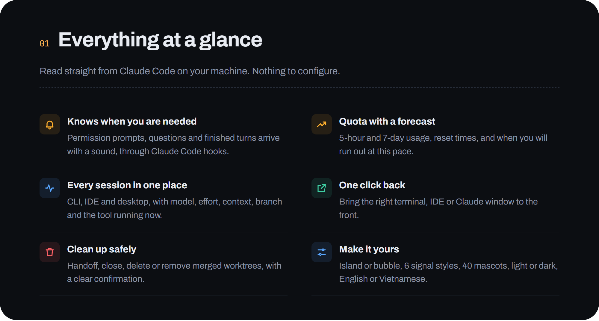
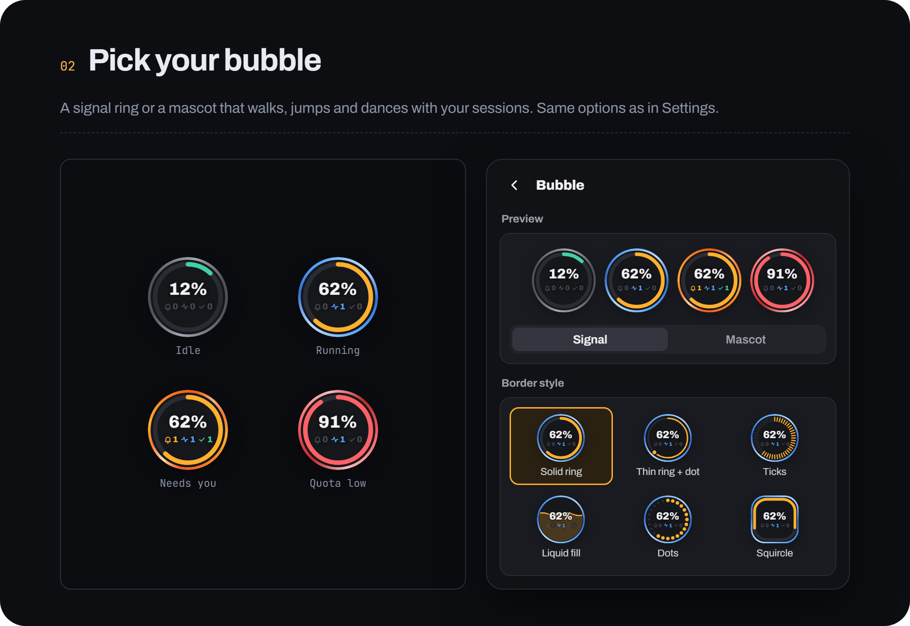

<!-- Chép từ docs/site/README.md (tools/shoot_landing.py), đổi đường dẫn cho thư mục gốc; sửa landing rồi chạy lại script và chép lại. -->
<p align="center"></p>

<p align="center"><b>Wisp floats at the top of your screen: quota with a forecast, every running session, and a gentle nudge when one is waiting for you.</b></p>

<p align="center"><a href="https://github.com/hakienit/pet-tracker/releases/latest/download/wisp-win-x64.zip"><b>Download for Windows</b></a> · <a href="https://github.com/hakienit/pet-tracker/releases/latest/download/wisp-macos-universal2.dmg">macOS (beta)</a> · <a href="https://github.com/hakienit/pet-tracker/releases">Releases</a> · <a href="README.vi.md">Tiếng Việt</a></p>

<p align="center">  </p>

<p align="center"></p>
<p align="center"><sub>Idle, running, needs you, done: the island follows your sessions.</sub></p>

## Install in one line

Downloads the latest release, checks its SHA256 and starts Wisp. Run it again to update. Requires Claude Code, signed in.

Windows 10/11, in PowerShell:

```powershell
irm https://raw.githubusercontent.com/hakienit/pet-tracker/main/install.ps1 | iex
```

macOS (beta), in Terminal:

```bash
curl -fsSL https://raw.githubusercontent.com/hakienit/pet-tracker/main/install.sh | bash
```

Manual download: [wisp-win-x64.zip](https://github.com/hakienit/pet-tracker/releases/latest/download/wisp-win-x64.zip) · [wisp-macos-universal2.dmg](https://github.com/hakienit/pet-tracker/releases/latest/download/wisp-macos-universal2.dmg)

<p align="center"></p>

<p align="center"></p>

<p align="center"></p>

## Use

| Action | Result |
|---|---|
| Click the island or bubble | open / close the panel |
| Right-click the island or bubble | refresh, settings, switch island / bubble, mute 1 hour, check for updates, quit |
| Click a session | bring its window to the front |
| Right-click a session, or ⋯ | open folder, copy ID, details, mute, handoff, close, delete |
| Click a lane title | collapse / expand that lane |

## Private by design

Wisp reads Claude Code data on your machine only (`~/.claude`). Your login token goes only to `api.anthropic.com` for quota; turn it off with `"quota_api_enabled": false`. Hooks post to `127.0.0.1` only.

## Learn more

- [Full guide](docs/GUIDE.md) · [Changelog](CHANGELOG.md) · [Website](https://hakienit.github.io/pet-tracker/site/) · [Design spec](https://hakienit.github.io/pet-tracker/site/design.html)

<sub>Wisp is a personal project, not an Anthropic product. Quota uses the unofficial endpoint behind Claude Code's `/usage` and may change at any time.</sub>
