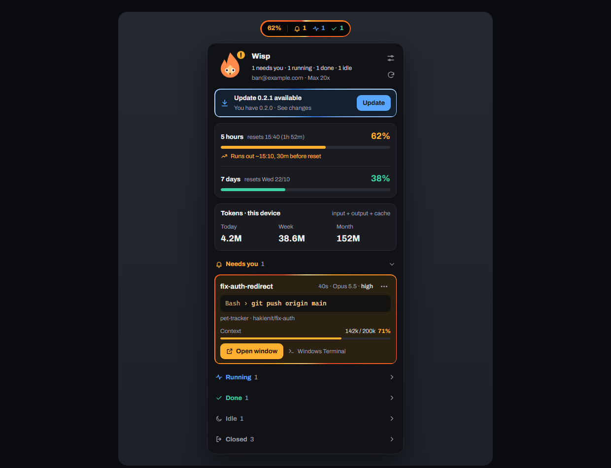
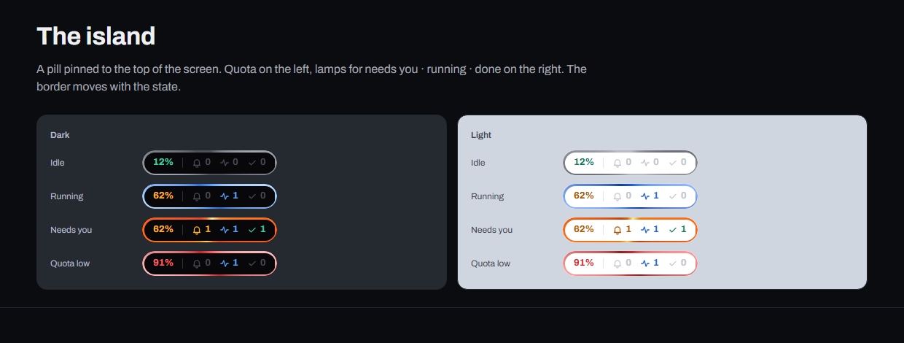
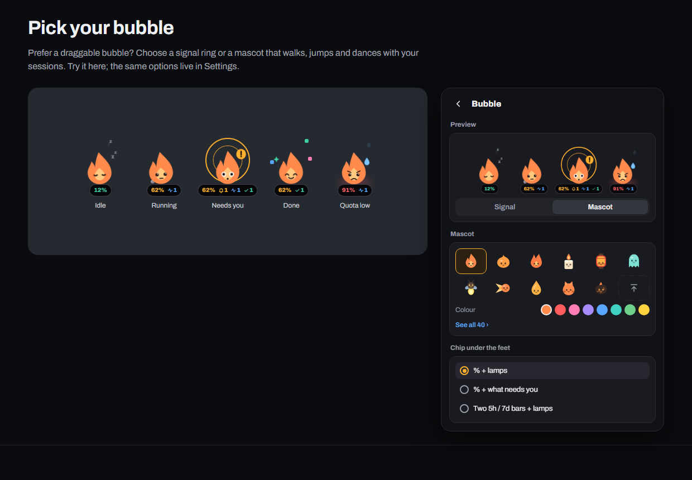
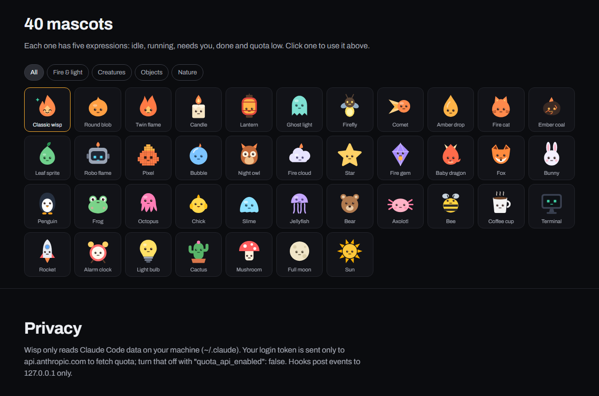

<!-- Draft README (English) for Wisp 0.2. On release: move to the repo root as README.md and
     fix relative paths (img/ -> docs/site/img/, ../../ -> ./, ../GUIDE.md -> docs/GUIDE.md). -->
<p align="center"></p>

<h1 align="center">Wisp</h1>

<p align="center">
  <b>A small flame that watches your Claude Code agents.</b><br>
  Quota, every running session and what needs you, always at the top edge of your screen.
</p>

<p align="center">
  <a href="https://github.com/hakienit/pet-tracker/releases/latest"></a>
  
  
  <a href="README.vi.md"></a>
</p>

<p align="center"></p>

## Install with one command

**Windows 10/11**, paste into PowerShell:

```powershell
irm https://raw.githubusercontent.com/hakienit/pet-tracker/main/install.ps1 | iex
```

**macOS** (beta), paste into Terminal:

```bash
curl -fsSL https://raw.githubusercontent.com/hakienit/pet-tracker/main/install.sh | bash
```

The command downloads the latest release, checks its SHA256, installs and starts Wisp, with no SmartScreen or
Gatekeeper warning. Run it again to update; on Windows the **Update** button in the app does the same. Requires
Claude Code, installed and signed in.

Manual download: [Windows .zip](https://github.com/hakienit/pet-tracker/releases/latest/download/wisp-win-x64.zip) ·
[macOS .dmg](https://github.com/hakienit/pet-tracker/releases/latest/download/wisp-macos-universal2.dmg) ·
[all releases](https://github.com/hakienit/pet-tracker/releases)

## What Wisp shows

- **What needs you**: permission prompts, questions and finished turns appear on the island with a sound,
  through Claude Code hooks (you are asked once before Wisp adds them).
- **Quota with a forecast**: 5-hour and 7-day usage, reset times, and when you will run out at the current pace.
- **Tokens on this device**: today, this week and this month, counted from this machine only.
- **Every session**: CLI, IDE and Claude desktop, grouped into needs you · running · done · idle, with model,
  effort, context, git branch and the tool running now.
- **One click back**: click a session to bring its terminal, IDE or Claude desktop window to the front.
- **Safe clean-up**: handoff and close, close, delete, remove merged worktrees, each with a clear confirmation.
- **Self-updating**: checks for a new version every 24 hours, one-click signed update on Windows.

<p align="center"></p>

## Make it yours

Island or draggable bubble. The bubble is a signal ring (6 styles) or a mascot that walks, jumps and dances
with your sessions: 40 mascots, 8 colours, or your own PNG/SVG. Light or dark theme, English or Vietnamese.
Everything lives in **Settings**.

<p align="center"></p>
<p align="center"></p>

## Use

| Action | Result |
|---|---|
| Click the island or bubble | open / close the panel |
| Right-click the island or bubble | refresh, settings, switch island / bubble, mute 1 hour, check for updates, quit |
| Click a session | bring its window to the front |
| Right-click a session, or ⋯ | open folder, copy ID, details, mute, handoff, close, delete |
| Click a lane title | collapse / expand that lane |

## Privacy

Wisp only reads Claude Code data on your machine (`~/.claude`). Your login token is sent only to
`api.anthropic.com` to fetch quota; turn it off with `"quota_api_enabled": false` in `config.json`. Hooks post
events to `127.0.0.1` only, and can be removed from Settings.

## Learn more

- [Website](https://hakienit.github.io/pet-tracker/site/) · [Design spec](https://hakienit.github.io/pet-tracker/site/design.html)
- [Full guide](../GUIDE.md): configuration, macOS, how context and quota are computed, window focus, build and release
- [Changelog](../../CHANGELOG.md)

<sub>Wisp is a personal project, not an Anthropic product. Quota comes from the unofficial endpoint used by
Claude Code's `/usage` command and may change at any time.</sub>
