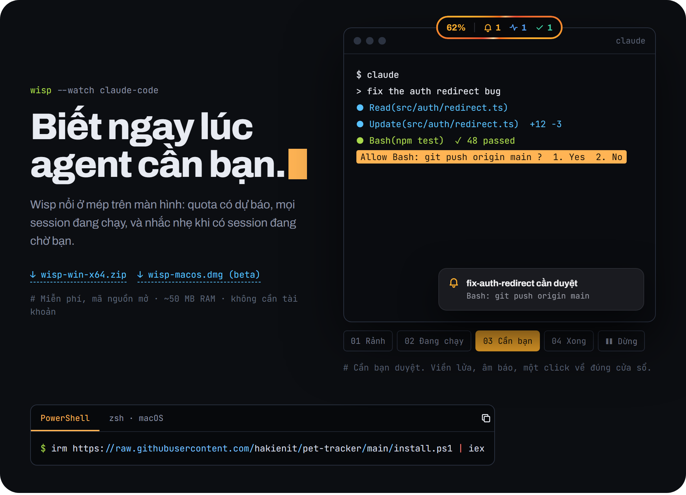
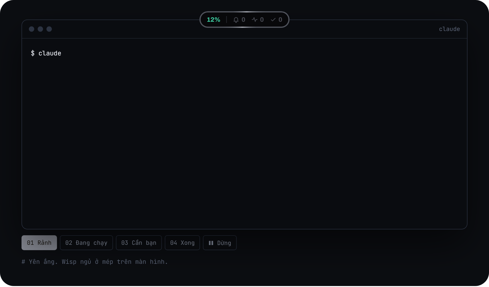
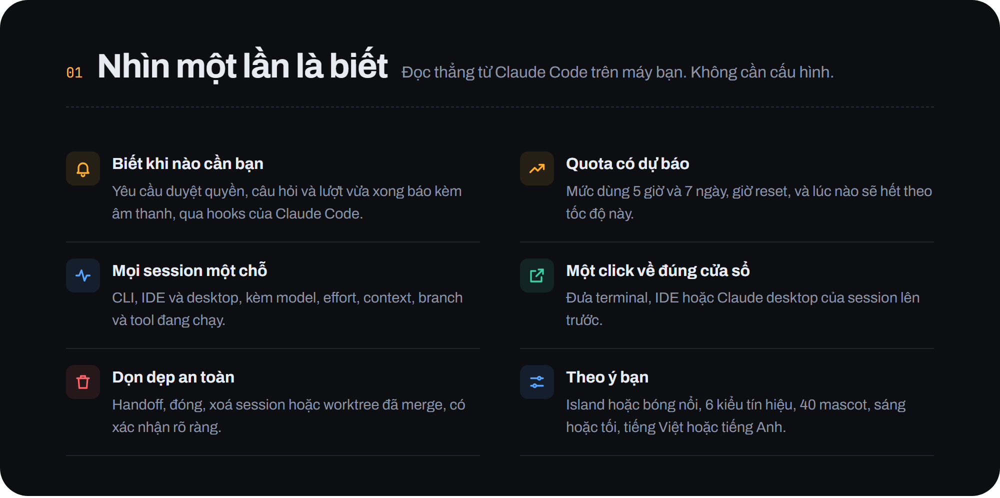
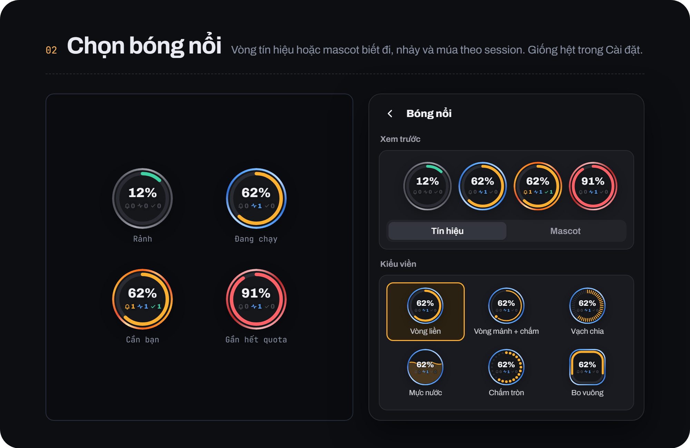
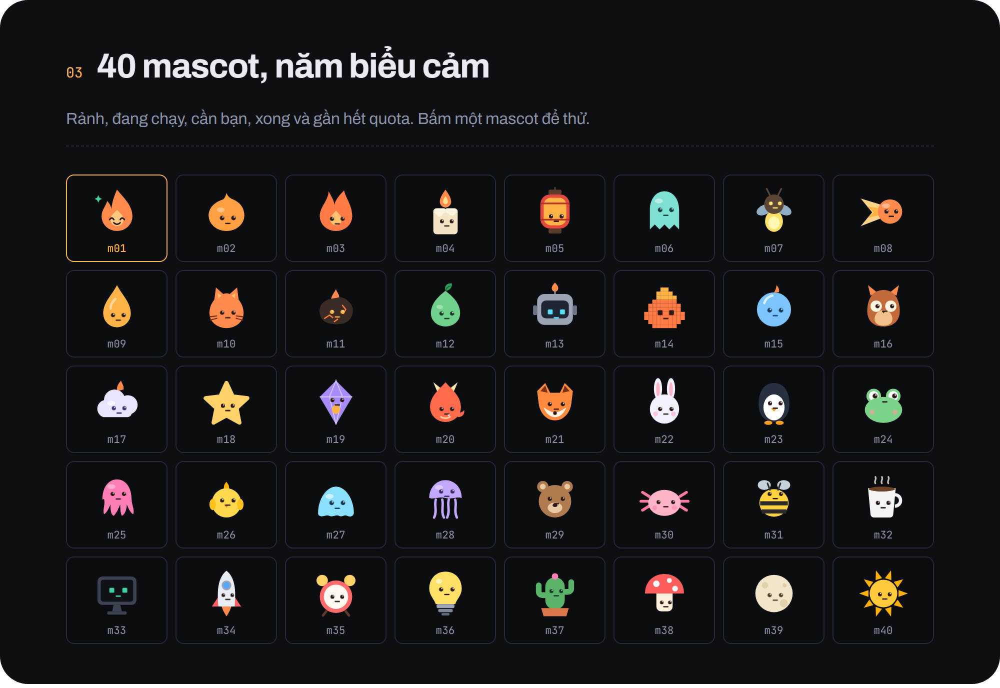

<!-- Tạo bởi tools/shoot_landing.py từ docs/site/index.html; sửa landing rồi chạy lại script, đừng sửa tay. -->
<p align="center"></p>

<p align="center"><b>Wisp nổi ở mép trên màn hình: quota có dự báo, mọi session đang chạy, và nhắc nhẹ khi có session đang chờ bạn.</b></p>

<p align="center"><a href="https://github.com/hakienit/pet-tracker/releases/latest/download/wisp-win-x64.zip"><b>Tải cho Windows</b></a> · <a href="https://github.com/hakienit/pet-tracker/releases/latest/download/wisp-macos-universal2.dmg">macOS (thử nghiệm)</a> · <a href="https://github.com/hakienit/pet-tracker/releases">Releases</a> · <a href="README.md">English</a></p>

<p align="center">  </p>

<p align="center"></p>
<p align="center"><sub>Rảnh, đang chạy, cần bạn, xong: island đổi theo session của bạn.</sub></p>

## Cài bằng một dòng

Tải bản mới nhất, kiểm SHA256 rồi mở Wisp. Chạy lại để cập nhật. Cần Claude Code đã đăng nhập.

Windows 10/11, dán vào PowerShell:

```powershell
irm https://raw.githubusercontent.com/hakienit/pet-tracker/main/install.ps1 | iex
```

macOS (thử nghiệm), dán vào Terminal:

```bash
curl -fsSL https://raw.githubusercontent.com/hakienit/pet-tracker/main/install.sh | bash
```

Tải tay: [wisp-win-x64.zip](https://github.com/hakienit/pet-tracker/releases/latest/download/wisp-win-x64.zip) · [wisp-macos-universal2.dmg](https://github.com/hakienit/pet-tracker/releases/latest/download/wisp-macos-universal2.dmg)

<p align="center"></p>

<p align="center"></p>

<p align="center"></p>

## Dùng

| Thao tác | Kết quả |
|---|---|
| Click vào island hoặc bóng | mở / đóng panel |
| Click phải vào island hoặc bóng | làm mới, cài đặt, đổi island / bóng, tắt âm thanh 1 giờ, kiểm tra cập nhật, thoát |
| Click vào session | đưa cửa sổ của session lên trước |
| Click phải vào session, hoặc ⋯ | mở thư mục, sao chép ID, chi tiết, tắt thông báo, handoff, đóng, xoá |
| Click vào tên làn | thu / mở làn đó |

## Riêng tư từ đầu

Wisp chỉ đọc dữ liệu Claude Code trên máy bạn (`~/.claude`). Token chỉ gửi tới `api.anthropic.com` để lấy quota; tắt bằng `"quota_api_enabled": false`. Hooks chỉ gửi tới `127.0.0.1`.

## Tìm hiểu thêm

- [Hướng dẫn đầy đủ](../GUIDE.md) · [Lịch sử thay đổi](../../CHANGELOG.md) · [Website](https://hakienit.github.io/pet-tracker/site/) · [Spec thiết kế](https://hakienit.github.io/pet-tracker/site/design.html)

<sub>Wisp là dự án cá nhân, không phải sản phẩm của Anthropic. Quota dùng endpoint không chính thức của lệnh `/usage` trong Claude Code, có thể đổi bất kỳ lúc nào.</sub>
