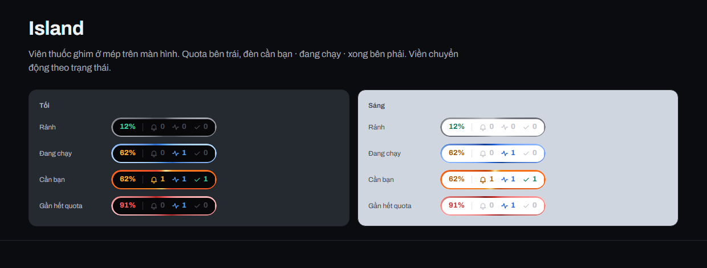
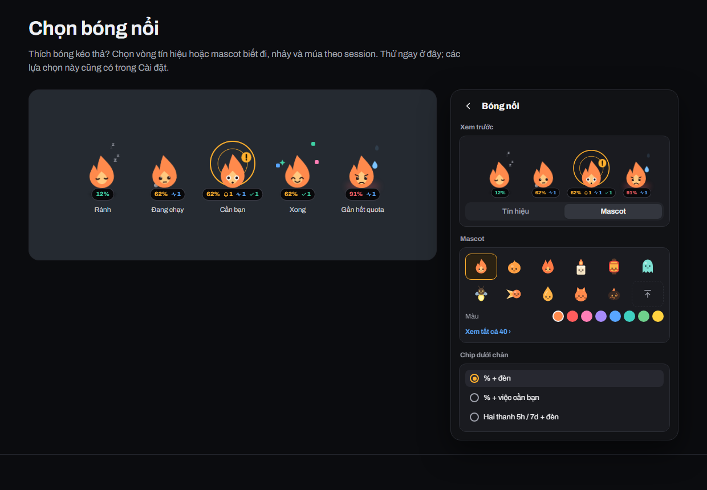

<!-- Bản nháp README (Tiếng Việt) cho Wisp 0.2. Khi release: chuyển ra gốc repo thành README.vi.md và
     sửa đường dẫn tương đối (img/ -> docs/site/img/, ../../ -> ./, ../GUIDE.md -> docs/GUIDE.md). -->
<p align="center"></p>

<h1 align="center">Wisp</h1>

<p align="center">
  <b>Đốm lửa nhỏ canh các agent Claude Code của bạn.</b><br>
  Quota, mọi session đang chạy và việc cần bạn, luôn ở mép trên màn hình.
</p>

<p align="center">
  <a href="https://github.com/hakienit/pet-tracker/releases/latest"></a>
  
  
  <a href="README.md"></a>
</p>

<p align="center"></p>

## Cài bằng một lệnh

**Windows 10/11**, dán vào PowerShell:

```powershell
irm https://raw.githubusercontent.com/hakienit/pet-tracker/main/install.ps1 | iex
```

**macOS** (thử nghiệm), dán vào Terminal:

```bash
curl -fsSL https://raw.githubusercontent.com/hakienit/pet-tracker/main/install.sh | bash
```

Lệnh tải bản mới nhất, kiểm SHA256, cài rồi mở app, không vướng cảnh báo SmartScreen hay Gatekeeper. Chạy lại để
cập nhật; trên Windows, nút **Cập nhật** trong app cũng làm việc này. Cần Claude Code đã cài và đăng nhập.

Tải tay: [Windows .zip](https://github.com/hakienit/pet-tracker/releases/latest/download/wisp-win-x64.zip) ·
[macOS .dmg](https://github.com/hakienit/pet-tracker/releases/latest/download/wisp-macos-universal2.dmg) ·
[mọi bản](https://github.com/hakienit/pet-tracker/releases)

## Wisp cho bạn thấy gì

- **Việc cần bạn**: yêu cầu duyệt quyền, câu hỏi và lượt vừa xong hiện trên island kèm âm thanh, qua hooks của
  Claude Code (Wisp hỏi bạn một lần trước khi thêm hooks).
- **Quota có dự báo**: mức dùng 5 giờ và 7 ngày, giờ reset, và lúc nào sẽ hết theo tốc độ hiện tại.
- **Token trên máy này**: hôm nay, tuần này, tháng này, chỉ tính trên máy đang chạy Wisp.
- **Mọi session**: CLI, IDE và Claude desktop, xếp theo cần bạn · đang chạy · xong · rảnh, kèm model, effort,
  context, git branch và tool đang chạy.
- **Một click về đúng cửa sổ**: bấm vào session để đưa terminal, IDE hoặc Claude desktop của nó lên trước.
- **Dọn dẹp an toàn**: handoff rồi đóng, đóng, xoá session, xoá worktree đã merge, mỗi thao tác có xác nhận rõ.
- **Tự cập nhật**: kiểm tra bản mới mỗi 24 giờ, cập nhật một chạm có kiểm chữ ký trên Windows.

<p align="center"></p>

## Theo ý bạn

Island hoặc bóng nổi kéo thả. Bóng nổi là vòng tín hiệu (6 kiểu) hoặc mascot biết đi, nhảy và múa theo session:
40 mascot, 8 màu, hoặc ảnh PNG/SVG của bạn. Giao diện sáng hoặc tối, tiếng Việt hoặc tiếng Anh. Tất cả nằm trong
**Cài đặt**.

<p align="center"></p>
<p align="center"></p>

## Dùng

| Thao tác | Kết quả |
|---|---|
| Click vào island hoặc bóng | mở / đóng panel |
| Click phải vào island hoặc bóng | làm mới, cài đặt, đổi island / bóng, tắt âm thanh 1 giờ, kiểm tra cập nhật, thoát |
| Click vào session | đưa cửa sổ của session lên trước |
| Click phải vào session, hoặc ⋯ | mở thư mục, sao chép ID, chi tiết, tắt thông báo, handoff, đóng, xoá |
| Click vào tên làn | thu / mở làn đó |

## Riêng tư

Wisp chỉ đọc dữ liệu Claude Code trên máy (`~/.claude`). Token đăng nhập chỉ được gửi tới `api.anthropic.com` để
lấy quota; tắt hẳn bằng `"quota_api_enabled": false` trong `config.json`. Hooks chỉ gửi sự kiện tới `127.0.0.1` và
gỡ được trong Cài đặt.

## Tìm hiểu thêm

- [Website](https://hakienit.github.io/pet-tracker/site/) · [Spec thiết kế](https://hakienit.github.io/pet-tracker/site/design.html)
- [Hướng dẫn đầy đủ](../GUIDE.md): cấu hình, macOS, cách tính context và quota, focus cửa sổ, build và release
- [Lịch sử thay đổi](../../CHANGELOG.md)

<sub>Wisp là dự án cá nhân, không phải sản phẩm của Anthropic. Quota lấy từ endpoint không chính thức mà lệnh
`/usage` của Claude Code dùng, có thể đổi bất kỳ lúc nào.</sub>
